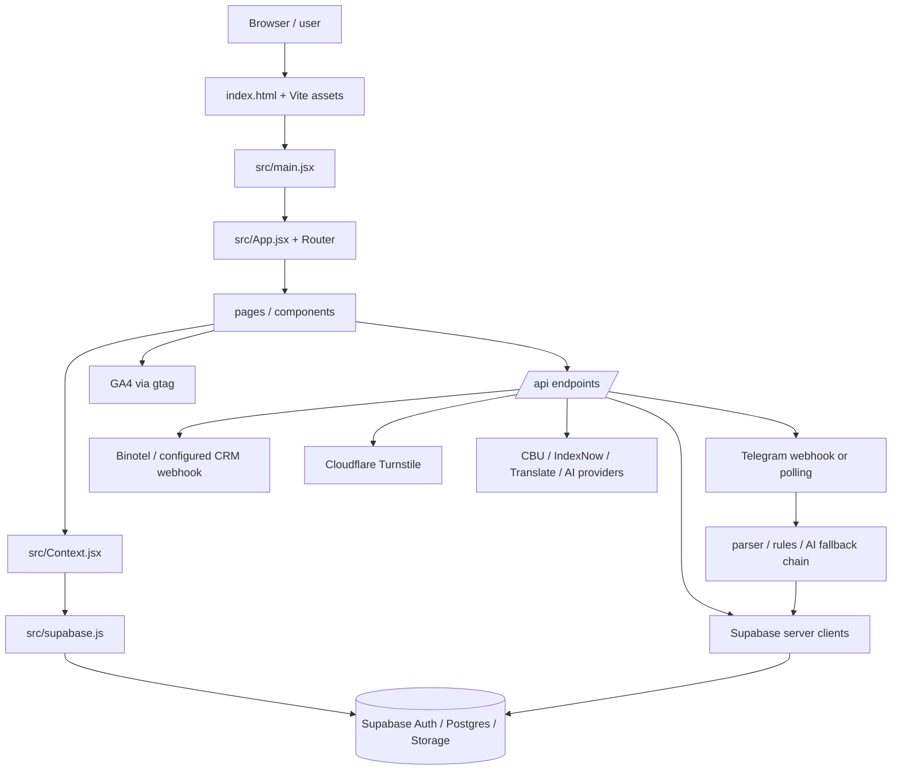
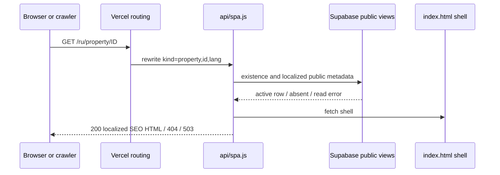

# Architecture

## System map

This map reflects code integrations. Optional env-gated connections and their production state are listed in `INTEGRATIONS.md`.

## Frontend and server boundary

- Vite produces `dist/` static browser assets. `index.html` contains the client entry, resource hints and env substitution.
- `main.jsx` creates the React app/router/context; `App.jsx` declares localized routes, client account/admin routes and lazy page imports.
- Client code uses Supabase publishable/anon credentials and authenticated user sessions. It cannot hold server secrets.
- Top-level `api/*.js` files are Vercel serverless entrypoints. Shared internal helpers are mostly `api/_*.js`; do not expose them as routes unless a new route is intentional.
- `server/bot.js` is a standalone Node process for long polling; the webhook route is a separate Vercel runtime mode. Both use shared parser/listing helpers.

## Request routing

`vercel.json` processes host redirects and legacy redirects, then maps `/sitemap.xml`, localized SEO page/object/district paths to `api/spa`, auth/admin client paths to `index.html`, and remaining paths to SPA 404 handler. Asset and media cache headers are configured separately. Rewrites are ordered and have SEO/status semantics; verify behavior when changing.

## Listing publish path

1. Telegram ingress (webhook or polling) identifies a supported post/update, saves pending album media when needed, and invokes shared parser.
2. Parser tries configured providers and validates model output against extracted/factual rules; regex fallback exists. Provider keys are optional/config-dependent.
3. Listing DB helpers write core row and related detail/media; IndexNow notification is best-effort according to environment conditions.
4. Public API and SPA routes read approved public views. `is_sold`/view behavior depends on SQL/view version currently deployed.
5. Admin/user flows edit listings through `Context.jsx`; endpoint/database RLS must remain the actual authorization boundary.

## Lead path

1. UI forms call `sendLead()` or LeadPopup wrappers; payload has source and form data.
2. `/api/lead` applies source and field sanitation, rate/origin checks, honeypot/Turnstile, idempotency/deduplication and classification.
3. Server stores to `leads`, optionally assigns an employee/manager, attempts Binotel and CRM webhook, and sends a Telegram message.
4. Client emits success analytics only after response; admin leads UI reads and updates CRM statuses.

Failure and retry behavior is endpoint-specific; see `API.md`. Successful lead storage and all downstream integration deliveries are not equivalent.

## Auth and roles

Supabase Auth session events are observed in `Context.jsx`; role/profile comes from `profiles`. Route guards control displayed admin/user pages. SQL files contain RLS and `is_admin()`/phone RPC definitions. Do not trust client role alone for sensitive mutation, and do not assume source SQL equals production policy.

## Locale and SEO path

Client locale: `src/i18n.js` and translation JSON. Localized paths and URL helpers are under `src/utils`. Client metadata is handled by `Seo.jsx`; Vercel pre-rendered crawler metadata is composed by `api/_seoMeta.js` and `api/spa.js`. Dynamic listing data, availability and translation coverage gate canonical/hreflang/sitemap entries. Details in `SEO_GEO.md`.

## Build/runtime operational boundary

Vite build and tests are local. Vercel domain, env, deployment, cron and cache state are external. Supabase schema/data/RLS and Edge function deployment are external. There is no production deployment credential in this documentation or archive.
