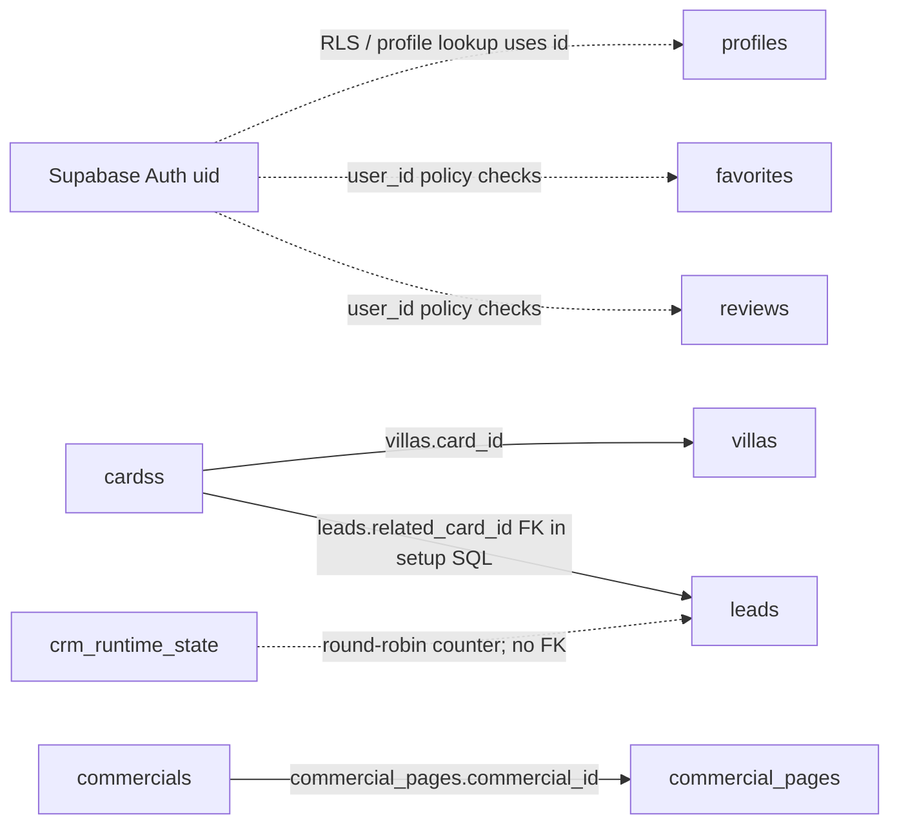

# Database and Supabase

## Evidence and boundary

This inventory is inferred from SQL in `sql/` and `supabase/`, plus `.from()` / `.rpc()` calls in source. The project ZIP has no production DB connection or schema export. Therefore the list below is **code/migration evidence**, not an authoritative live schema or claim that each script ran. Do not replay SQL automatically: many scripts alter RLS, views, retention, grants, functions, or storage policies.

## Relations referenced in code

| Relation / storage | Purpose inferred from callers | Evidence / caveat |
|---|---|---|
| `cardss` | Residential core records; source for `cardss_public`; writes and user listings | Main table definition is not present as a create-table migration in the snapshot |
| `villas` | Residential extended details, linked via `card_id`; media, location, amenities | Query code and RPC SQL; production FK/index details unknown |
| `cardss_public` (view) | Public residential catalog, SEO metadata, sitemap | `sql/recreate_public_views.sql`, `sql/add_sold_flag.sql`, `supabase/user_listings_and_leads.sql` include view definitions; actual production view differs until checked |
| `commercials` | Commercial core records, deal and owner data | Main table definition not present here |
| `commercial_pages` | Extended commercial details linked by `commercial_id` | Queries and setup scripts; schema/version not live-verified |
| `commercials_public` (view) | Public commercial catalog, SEO and sitemap | View scripts filter sold rows in supplied definitions; confirm deployed view |
| `profiles` | Auth-linked public profile, role and private phone | `security_hardening.sql`, `profiles_privacy.sql`; phone column permissions are explicitly restricted in supplied script |
| `favorites` | Per-user saved listings | Read/write calls in Context and RLS policy definitions |
| `reviews` | User reviews, public listing, moderation/admin operations | Read/write code and RLS definitions; review integrity/current rows unknown |
| `leads` | Contact and listing-owner leads, status, routing, CRM sync | Server/API and lead admin code; cleanup scripts alter retention |
| `bot_pending_albums` | Staging Telegram media-group messages until complete | Telegram webhook/finalizer; migration scripts add video/album fields |
| `exchange_rates` | Stored currency rate/date read by client and SEO/API | `sql/add_exchange_rates.sql`; exact production columns from migration |
| `crm_runtime_state` | Atomic counter for round-robin lead assignment | Created in `sql/add_lead_crm_fields.sql`; function `next_lead_manager_index` |
| Storage bucket `images` | User/admin and Telegram-imported public media | SQL policies refer to bucket `images`; bucket settings/storage metadata not verifiable |
| Storage bucket `videos` | Video upload/read references | Code writes to `videos`; snapshot has no authoritative bucket provisioning/status report |

`src`/API also call `get_my_listing_full`, `get_profile_phone`, `next_lead_manager_index`, and `append_album_video` RPCs. Verify their deployed signatures, grants and `SECURITY DEFINER` behavior before changing callers or migration files.

## Data relationships seen in source

These are source/query/policy conventions and links stated by supplied SQL; they are not a live production ERD. `leads` and `crm_runtime_state` are independent records with no FK shown between them.

## Views and business rules

- `cardss_public` / `commercials_public` project public listing fields and the SQL scripts supplied here exclude records where `coalesce(is_sold,false)` is true.
- `add_sold_flag.sql` adds `is_sold`, `sold_at`, and adjusts existing view definitions; `updated_at`/`seo_lastmod` treatment varies by script version. Review exact file before applying.
- API SEO checks query public views; residential uses `villas.card_id`; commercial detail pages may exist without `commercial_pages` rows.
- User listing SQL scripts grant column-level select and define RLS writes. Their rules are not interchangeable with `security_hardening.sql` or `admin_only_listings.sql`; these scripts have different purposes and may reset policies.

## RLS and function definitions in files

`security_hardening.sql` defines `is_admin()` and policies for profiles, listings, favorites, reviews, image storage, leads and related operations. `profiles_privacy.sql` limits selected profile columns and grants phone access through `get_profile_phone(uuid)` to authenticated user/admin. `admin_only_listings.sql` removes older owner-write policies and grants writes through admin checks. `user_listings_and_leads.sql` is broad initial/combined setup: it modifies listing tables/views, leads and policies. Treat it as an operator-reviewed setup script, not as a migration to rerun casually.

No production policies were read or altered in this audit. Never infer “secure in prod” from the presence of a policy file.

## SQL file inventory

| File | Scope inferred from statements/name |
|---|---|
| `add_album_video.sql` | Add video field to pending album and `append_album_video` function |
| `add_boost.sql` | `boosted_until` on residential/commercial records |
| `add_exchange_rates.sql` | Create FX table, RLS, public read grant |
| `add_gallery_videos.sql` | Video arrays on residential/commercial details |
| `add_is_rent.sql` | Rent flag on residential/commercial core records |
| `add_is_rent_detail_tables.sql` | Rent flag/related fields on detail records |
| `add_lead_antispam_indexes.sql` | Lead idempotency/dedup indices and anti-repeat support |
| `add_lead_cleanup.sql` | Optional pg_cron retention: null raw data after 90d; delete selected leads after 12mo |
| `add_lead_crm_fields.sql` | CRM fields, indices, counter table and round-robin RPC |
| `add_sold_flag.sql` | Sold columns/grants and public view filtering/update |
| `add_video_support.sql` | Video fields for listing data; inspect script for exact tables |
| `fix_album_pipeline.sql` | Repair/normalize Telegram album persistence path |
| `fix_telegram_pipeline.sql` | Telegram listing pipeline correction |
| `optional_add_card_floor.sql` | Optional floor field support |
| `recreate_public_views.sql` | Rebuild `cardss_public`, `commercials_public` projections |
| `advanced_property_search.sql` | Pending: derived public search views, trigram indexes and invoker-rights paginated catalog RPC; not applied or production-validated |
| `replace_villa_type_text.sql` | Data/text conversion for residence type; inspect before production use |

Supabase scripts: `admin_only_listings.sql`, `profiles_privacy.sql`, `security_hardening.sql`, `user_commercial_pages_access.sql`, `user_listing_full_rpc.sql`, `user_listings_and_leads.sql`; Edge Function config/code under `supabase/functions/delete-account/`.

## Safe database workflow

1. Identify target production schema/backup and check migration history first.
2. Diff SQL against live schema; check grants, RLS, view dependencies, ownership, RPC callers and rollback path.
3. Use a non-production environment and approved migration workflow. Never run scripts from this archive in production without explicit approval.
4. After approved migration, test anon/authenticated/admin access and client query projections; refresh API docs if contracts changed.
